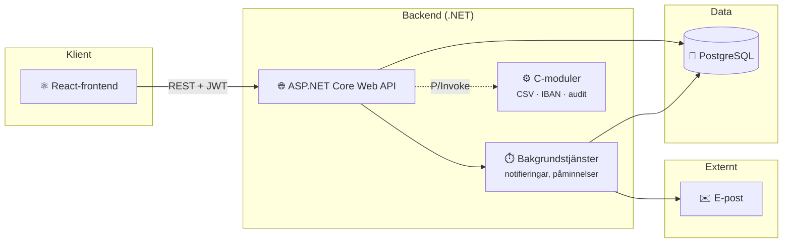

# SEB Företagsbetalningar

En betalningsportal för SEB:s företagskunder (SME). Företag kan skapa betalningar
från sina konton, och betalningarna måste attesteras av behöriga personer innan
de genomförs. Allt som händer loggas i en granskningslogg.

Projektet är en ombyggnad (v2) av ett äldre Razor Pages-system till ett modernt
REST-API med separat React-frontend.

## Funktioner

- **Betalningar**: en initiator skapar betalningar från företagets konton.
  Saldot reserveras direkt, och idempotensnycklar förhindrar dubbla betalningar
  vid omförsök.
- **Attestflöde i flera steg**: beloppsgränser per företag styr hur många
  attesteringar en betalning kräver. Den som skapat betalningen kan aldrig
  attestera den själv.
- **Granskningslogg**: varje betalning, attestering och administrativ ändring
  loggas med vem, vad och när. Loggen kan filtreras och exporteras.
- **Notifieringar**: attestanter meddelas via e-post och i appen, får automatiska
  påminnelser om väntande attesteringar, och misslyckade utskick görs om.
- **Multi-tenant**: flera företag delar systemet, men varje företag ser bara
  sina egna användare, konton och betalningar.
- **Roller**: Admin, Initiator och Attestant, med olika behörigheter.
- **Säker inloggning**: JWT med refresh tokens, och lösenord hashas med BCrypt.

## Teknisk stack

| Del               | Teknik                                            |
| ----------------- | ------------------------------------------------- |
| Backend           | ASP.NET Core 8 Web API, EF Core 8                 |
| Databas           | PostgreSQL                                        |
| Frontend          | React 18, TypeScript, Vite, TanStack Query/Router |
| Native            | C-moduler för CSV-parsning, IBAN och audit        |
| Drift             | Docker Compose                                    |
| API-dokumentation | Scalar / OpenAPI (`/scalar/v1`)                   |

## Köra lokalt

Krav: Docker Desktop (Windows/Mac) eller Docker Engine (Linux). På Windows behöver Docker Desktop WSL2, se vanliga fel nedan.

```bash
cd infra
docker compose up --build
```

Appen svarar sedan på http://localhost:PORT. Vilken port som gäller för ert case står i `infra/docker-compose.override.yml`. Inloggningsuppgifter till seed-datan står i README.

- Stoppa: Ctrl+C, eller `docker compose down`
- Börja om med tom databas: `docker compose down -v` och sedan `up --build` igen

## Vanliga fel lokalt

- **"WSL 2 installation is incomplete" (Windows):** kör `wsl --install` i PowerShell som administratör, starta om datorn, starta Docker Desktop igen.
- **"port is already allocated":** någon annan process använder porten. Stäng den, eller ändra porten i `infra/docker-compose.override.yml` (den filen är er att ändra).
- **Kodändringar syns inte:** ni har glömt `--build`.
- **Databasen i konstigt läge:** `docker compose down -v` och börja om. Volymen är bara lokal, inget försvinner i driftmiljön.

# Säkerhet och behörighet

Varje användare tillhör en tenant (ett företag) och har en av tre roller:
**Initiator**, **Attestant** eller **Admin**. Rollen styr vilka delar av API:t
användaren har tillgång till, och tenant-kopplingen gör att en användare bara
ser data som tillhör det egna företaget.

En Admin har bara behörighet inom sin egen tenant. Varje företag har alltså en
eller flera egna administratörer som ansvarar för företagets användare och
inställningar.

Vid inloggning får användaren två JWT-baserade tokens:

- **Accesstoken** skickas med varje anrop och gäller i 15 minuter.
- **Refresh-token** används för att hämta en ny accesstoken och gäller i 7 dagar.

Hemligheter som anslutningssträngen och JWT-nyckeln hålls utanför källkoden.
Lokalt lagras de med User Secrets. Vid en produktionslansering skulle de flyttas
till en tjänst som Azure Key Vault.

## Felhantering

Felhanteringen är centraliserad, så controllers innehåller ingen try/catch-logik.
Felsvar uppstår på tre ställen:

1. **Validering av indata**: `[ApiController]` validerar inkommande DTO:er
   automatiskt och svarar med `400 Bad Request` innan controllern anropas.
2. **Förväntade utfall**: när en resurs inte finns eller en åtgärd inte är
   tillåten svarar controllern direkt med t.ex. `404 Not Found` eller
   `400 Bad Request`.
3. **Exceptions**: alla exceptions fångas av en global felhanterare
   (`GlobalExceptionHandler`) som översätter dem till rätt statuskod:

| Exception                                      | Statuskod                 |
| ---------------------------------------------- | ------------------------- |
| `ValidationException`, `BusinessRuleException` | 400 Bad Request           |
| `UnauthorizedAccessException`                  | 403 Forbidden             |
| `NotFoundException`                            | 404 Not Found             |
| `ServiceUnavailableException`                  | 503 Service Unavailable   |
| Övriga (oväntade fel)                          | 500 Internal Server Error |

# Betalningsflöde och affärsregler

Varje tenant har egna gränser.

Exempel
| Belopp | Krav |
|-----------|-------------------------------------------|
| Under 50 000kr | Genomförs direkt, ingen attest |
| 50 000 - 199 999kr | 1 attestant |
| 200 000kr och mer | 2 attestanter |

De andra företagen har andra gränser, t.ex. 25 000 och 100 000 för tenant 2. En Admin kan ändra gränserna för sitt eget företag.

Affärsregler i koden

- Saldot dras direkt när betalningen skapas, även om den väntar på attest. Det går inte att betala mer än det som finns på kontot.
- Ingen kan attestera sin egen betalning, inte ens en Admin.
- Vid dubbelattest måste attestanterna vara olika personer. Finns det för få attestanter i företaget kan betalningen inte skapas.
- Ett enda nej räcker för att stoppa betalningen. Om ett steg nekas avslås hela betalningen, och pengarna förs tillbaka till kontot.
- Betalningen genomförs först när alla steg är godkända.
- En Admin kan besluta i stället för den tilldelade attestanten, men aldrig på sin egen betalning.

# Arkitektur

System översikt



Kärnan i flödet är **Controller → Service → Repository → DbContext → Databas**.

Innan ett anrop når controllern valideras indatan automatiskt, och ogiltiga
anrop stoppas redan där (se Felhantering). Controllern tar emot anropet,
kontrollerar behörigheten och skickar det vidare till rätt service.

I servicen finns affärslogiken. När en ny användare skapas är det till exempel
servicen som kontrollerar att e-postadressen inte redan används, hashar
lösenordet och bygger upp användarobjektet med det innehåll en användare ska ha.

Servicen lämnar sedan över till repositoryt, som ansvarar för kommunikationen
med databasen. Repositoryt använder DbContext (EF Core) för att skriva och läsa
data, och slutligen sparas användaren i databasen.

## Frontendarkitektur

Frontend är byggd med React och TypeScript. `main.tsx` sätter upp routingen med
TanStack Router och omsluter appen med TanStack Query samt providers för
inloggning och valuta. Skyddade routes kontrollerar användarens session och roll.

Sidorna i `src/pages` innehåller appens vyer och arbetsflöden. Återanvändbara
gränssnittskomponenter finns i `src/components`, medan `src/hooks` samlar
återanvändbar data- och statehantering. API-anrop ligger i `src/services` och går
via en gemensam funktion som skickar JWT och validerar svar med Zod-scheman från
`src/schemas`. Translations finns i `src/i18n`.

## Contributors
- https://github.com/LisaEbbhagen
- https://github.com/oligerta-braholli
- https://github.com/meskilsson
- https://github.com/AlCapone1234
- https://github.com/Grahnnen
- https://github.com/niklaserikssoon
- https://github.com/JohannesFolkesson
- https://github.com/isashiphotmailcom
- https://github.com/CitizenSmithDev
