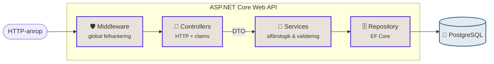
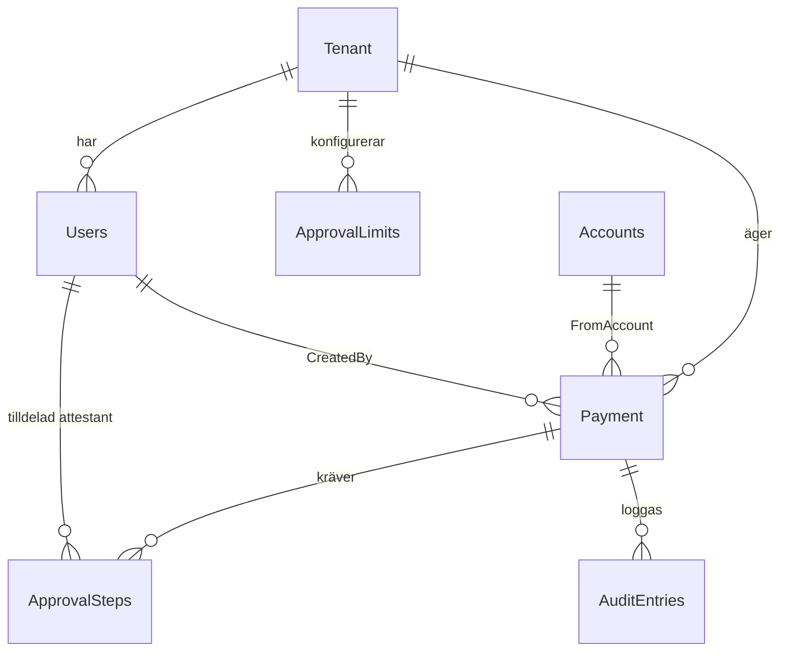
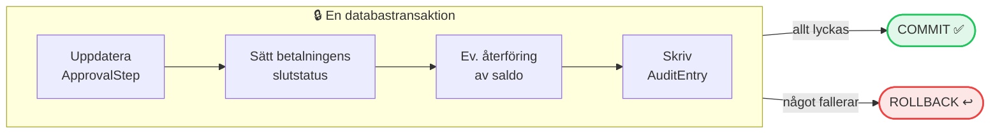
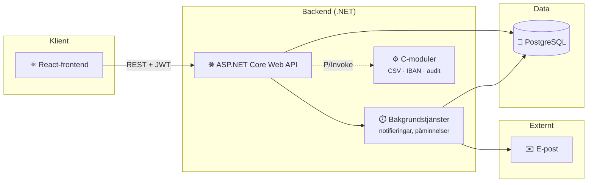

# SEB Företagsbetalningar

En betalningsportal för SEB:s företagskunder (SME). Företag kan skapa betalningar
från sina konton, och betalningarna måste attesteras av behöriga personer innan
de genomförs. Allt som händer loggas i en granskningslogg.

Projektet är en ombyggnad (v2) av ett äldre Razor Pages-system till ett modernt
REST-API med separat React-frontend.

## Funktioner

- **Betalningar**: en initiator skapar betalningar från företagets konton.
  Saldot reserveras direkt, och idempotensnycklar förhindrar dubbla betalningar
  vid omförsök.
- **Attestflöde i flera steg**: beloppsgränser per företag styr hur många
  attesteringar en betalning kräver. Den som skapat betalningen kan aldrig
  attestera den själv.
- **Granskningslogg**: varje betalning, attestering och administrativ ändring
  loggas med vem, vad och när. Loggen kan filtreras och exporteras.
- **Notifieringar**: attestanter meddelas via e-post och i appen, får automatiska
  påminnelser om väntande attesteringar, och misslyckade utskick görs om.
- **Multi-tenant**: flera företag delar systemet, men varje företag ser bara
  sina egna användare, konton och betalningar.
- **Roller**: Admin, Initiator och Attestant, med olika behörigheter.
- **Säker inloggning**: JWT med refresh tokens, och lösenord hashas med BCrypt.

## Teknisk stack

| Del               | Teknik                                            |
| ----------------- | ------------------------------------------------- |
| Backend           | ASP.NET Core 8 Web API, EF Core 8                 |
| Databas           | PostgreSQL                                        |
| Frontend          | React 18, TypeScript, Vite, TanStack Query/Router |
| Native            | C-moduler för CSV-parsning, IBAN och audit        |
| Drift             | Docker Compose                                    |
| API-dokumentation | Scalar / OpenAPI (`/scalar/v1`)                   |

## Köra lokalt

Krav: Docker Desktop (Windows/Mac) eller Docker Engine (Linux). På Windows behöver Docker Desktop WSL2, se vanliga fel nedan.

```bash
git clone <repo-url>
cd ChasChallenge
git checkout 3-seb

cd infra
docker compose up --build
```

Appen svarar sedan på http://localhost:PORT. Vilken port som gäller för ert case står i `infra/docker-compose.override.yml`. Inloggningsuppgifter till seed-datan står i README.

- Stoppa: Ctrl+C, eller `docker compose down`
- Börja om med tom databas: `docker compose down -v` och sedan `up --build` igen

## Vanliga fel lokalt

- **"WSL 2 installation is incomplete" (Windows):** kör `wsl --install` i PowerShell som administratör, starta om datorn, starta Docker Desktop igen.
- **"port is already allocated":** någon annan process använder porten. Stäng den, eller ändra porten i `infra/docker-compose.override.yml` (den filen är er att ändra).
- **Kodändringar syns inte:** ni har glömt `--build`.
- **Databasen i konstigt läge:** `docker compose down -v` och börja om. Volymen är bara lokal, inget försvinner i driftmiljön.

# Säkerhet och behörighet

Varje användare tillhör en tenant (ett företag) och har en av tre roller:
**Initiator**, **Attestant** eller **Admin**. Rollen styr vilka delar av API:t
användaren har tillgång till, och tenant-kopplingen gör att en användare bara
ser data som tillhör det egna företaget.

En Admin har bara behörighet inom sin egen tenant. Varje företag har alltså en
eller flera egna administratörer som ansvarar för företagets användare och
inställningar.

Vid inloggning får användaren två JWT-baserade tokens:

- **Accesstoken** skickas med varje anrop och gäller i 15 minuter.
- **Refresh-token** används för att hämta en ny accesstoken och gäller i 7 dagar.

Hemligheter som anslutningssträngen och JWT-nyckeln hålls utanför källkoden.
Lokalt lagras de med User Secrets. Vid en produktionslansering skulle de flyttas
till en tjänst som Azure Key Vault.

## Felhantering

Felhanteringen är centraliserad, så controllers innehåller ingen try/catch-logik.
Felsvar uppstår på tre ställen:

1. **Validering av indata**: `[ApiController]` validerar inkommande DTO:er
   automatiskt och svarar med `400 Bad Request` innan controllern anropas.
2. **Förväntade utfall**: när en resurs inte finns eller en åtgärd inte är
   tillåten svarar controllern direkt med t.ex. `404 Not Found` eller
   `400 Bad Request`.
3. **Exceptions**: alla exceptions fångas av en global felhanterare
   (`GlobalExceptionHandler`) som översätter dem till rätt statuskod:

| Exception                                      | Statuskod                 |
| ---------------------------------------------- | ------------------------- |
| `ValidationException`, `BusinessRuleException` | 400 Bad Request           |
| `UnauthorizedAccessException`                  | 403 Forbidden             |
| `NotFoundException`                            | 404 Not Found             |
| `ServiceUnavailableException`                  | 503 Service Unavailable   |
| Övriga (oväntade fel)                          | 500 Internal Server Error |

# Betalningsflöde och affärsregler

# 🏗️ Arkitektur & designbeslut

> En genomgång av de viktigaste tekniska besluten i projektet – **vad** vi byggt och framför allt **varför**.

## 📑 Innehåll

1. [Arkitektur och teknikval](#1-arkitektur-och-teknikval)
2. [Databasen](#2-databasen)
3. [Roller, flöde och säkerhet (Approval flow)](#3-roller-flöde-och-säkerhet-approval-flow)
4. [Säkerhet, konfiguration och kodstruktur](#4-säkerhet-konfiguration-och-kodstruktur)
5. [Atomicitet, concurrency, transaktionalitet och testbarhet](#5-atomicitet-concurrency-transaktionalitet-och-testbarhet)

---

## 1. Arkitektur och teknikval

### Från Razor Pages till ASP.NET Core Web API

> **💡 Varför?**
> För att modernisera projektet och skapa en frikopplad struktur där frontend och backend kan utvecklas, driftsättas och testas oberoende av varandra.



| Lager | Ansvar |
|---|---|
| **Controllers** | Hanterar inkommande HTTP-anrop och claim-extraktion |
| **DTO** | Säkerställer att endast nödvändig data skickas in och ut ur systemet |
| **Services** | Innehåller all affärslogik och komplex validering |
| **Repository** | Hanterar databasinteraktioner via Entity Framework Core |
| **Middleware** | Tillhandahåller global felhantering |

> **🧱 Lagerdelning**
> Koden följer en strikt lagerdelad modell för att undvika cirkulära beroenden, isolera affärslogiken och göra koden fullt testbar.

---

## 2. Databasen

Databasen består huvudsakligen av följande entiteter:

| | | | |
|---|---|---|---|
| `Accounts` | `ApprovalLimits` | `ApprovalSteps` | `AuditEntries` |
| `IdempotencyKey` | `Payment` | `Tenant` | `Users` |

Alla entiteter fyller en egen viktig funktion i helheten – men **kärnan** i det hela är `Payment`.

> **💡 Varför `Payment`?**
> `Payment` pekar på nästan alla andra entiteter på något sätt. Det är navet som konton, användare, tenants, attester och revisionsloggar kretsar kring.

### Entiteten `Payment`

| Fält | Beskrivning | Exempel |
|---|---|---|
| `PaymentId` | Betalningens egna ID | – |
| `TenantId` | Vilken tenant skaparen tillhör | – |
| `FromAccount` | Kontot pengarna dras från | – |
| `ToIban` | Mottagarkonto (i praktiken *ToAccount*, angivet som IBAN) | `SE45 5000 …` |
| `Amount` | Belopp | `25000` |
| `Currency` | Valuta | `SEK` |
| `Reference` | Referens till mottagaren | `Faktura 1234` |
| `Status` | Betalningens status | `pending` · `pending_approval` · `completed` |
| `CreatedByUserId` | Vem som skapade betalningen | – |
| `CreatedAt` | Tidpunkt då betalningen skapades | – |



Vårt centrala arkitekturbeslut kring `Payment` är ett **approval flow** 👇

---

## 3. Roller, flöde och säkerhet (Approval flow)

### 👥 Rollfördelning

| Roll | Får | Får inte |
|---|---|---|
| **Initiator** | Skapa betalningar | Godkänna betalningar |
| **Attestant** | Godkänna / neka betalningar | Skapa betalningar |
| **Admin** | Sätta beloppsregler för sin egen tenant | Påverka andra tenants |

> **💡 Varför?**
> Rollerna är kopplade till användaren och styr vem som får göra vad. En initiator får aldrig godkänna en betalning – **inte ens sin egen** om personen av misstag också skulle ha attestantrollen. Det är spärrat separat (self-approval-spärr).

### 🔄 Betalningens flöde

1. **Initiatorn skapar en betalning** → beloppet reserveras direkt från kontot och betalningen sparas som `pending_approval`.
2. **En regelmotor avgör antalet godkännanden** utifrån beloppet. Reglerna (`ApprovalLimit`) är konfigurerbara per tenant – inte hårdkodade – och sätts av tenantens admin.

   | Exempelregel | Krav |
   |---|---|
   | Under 10 000 kr | Genomförs direkt, ingen attest |
   | 100 000 kr och uppåt | 2 attestanters godkännande |

3. **Atteststeg skapas** (`ApprovalStep`) – ett per krävt godkännande – och tilldelas en attestant var. Vi valde **round-robin** över tenantens attestanter så att belastningen sprids, i stället för att lämna stegen otilldelade och låta "vem som helst" plocka dem.
4. **Attestanterna beslutar.** När samtliga steg är godkända markeras betalningen som `completed`. Nekas ett steg avbryts hela flödet och det reserverade beloppet **återförs automatiskt** till kontot.

### ✅ Valideringsregler vid beslut

Innan ett beslut tillåts kontrolleras att:

- [x] steget hör till rätt betalning
- [x] betalningen fortfarande väntar på attest
- [x] steget inte redan är beslutat
- [x] beslutsfattaren **inte** själv skapade betalningen (self-approval-spärr)
- [x] beslutsfattaren faktiskt är den **tilldelade** attestanten för steget

> **💡 Varför?**
> Samma attestant kan inte godkänna två gånger på samma betalning – dels för att varje steg bara får ett beslut, dels för att stegen tilldelas per attestant.

---

## 4. Säkerhet, konfiguration och kodstruktur

### 🔐 Miljöoberoende konfiguration

> **💡 Varför?**
> För att förhindra att känsliga uppgifter och anslutningssträngar läcker ut i versionshistoriken hanteras konfigurationen dynamiskt via `builder.Configuration`:
>
> | Miljö | Källa |
> |---|---|
> | Lokalt | User Secrets |
> | Docker | Miljövariabler |

### 🎫 Serverstyrd säkerhet & JWT

> **💡 Varför?**
> `TenantId` och spårbarhetsfält som `LastModifiedBy` extraheras direkt från den inloggade användarens JWT-token **på serversidan**, vilket förhindrar att klienter manipulerar data.
> Vid användarhantering används **BCrypt** för lösenordshashning, och känslig information exkluderas från DTO-svaren.

### 🏢 Obligatorisk multi-tenant-isolering i `AuditEntries`

> **💡 Varför?**
> `AuditEntries` har en obligatorisk `TenantId`-koppling (med tillhörande migrationer och kontextuppdateringar) så att händelse- och revisionsloggning är strikt isolerad per organisation.

### 🛡️ Tenant-validering för admin (IDOR-skydd)

> **💡 Varför?**
> Strikta kontroller i controllers och servicelager verifierar att en inloggad administratörs `TenantId` (från JWT) matchar målresursen. Det förhindrar obehörig åtkomst eller manipulation mellan olika tenants.

### 🪶 Tunna controllers

> **💡 Varför?**
> Controllers hålls medvetet tunna och ansvarar enbart för HTTP-anrop och claim-hantering. All komplex validering och affärslogik ligger i servicelagret.

---

## 5. Atomicitet, concurrency, transaktionalitet och testbarhet

### ⚡ Optimistisk concurrency via villkorade uppdateringar

> **💡 Varför?**
> Kravet var att implementera optimistic concurrency (`RowVersion`). Vi undersökte var det behövdes och kom fram till att våra faktiska skrivvägar redan skyddas på ett mer specifikt sätt: varje statusändring skrivs som en **villkorad databasuppdatering**.

```sql
-- Attestbeslut / betalningens slutstatus
UPDATE ... SET Status = @nyStatus WHERE Id = @id AND Status = 'pending';

-- Kontosaldo
UPDATE Accounts SET Balance = Balance - @belopp WHERE Id = @id AND Balance >= @belopp;
```

Databasen serialiserar själv samtidiga försök – **bara ett kan lyckas per rad**, övriga påverkar noll rader och avvisas i koden.

| | `RowVersion` | Villkorad `UPDATE` |
|---|---|---|
| Skyddar mot samtidiga ändringar | ✅ | ✅ |
| Kräver inläsning av posten först | Ja | Nej |
| Antal databasanrop | Läs + skriv | En skrivning |

Båda är i grunden en *"har något ändrats sedan jag läste det?"*-kontroll – men den villkorade varianten är billigare.

### 🔒 Atomära databastransaktioner

> **💡 Varför?**
> Hela beslutsflödet körs i **en och samma transaktion** – antingen går allt igenom eller inget. En attest kan därför aldrig lämna systemet i ett mellanläge.



### 📬 Polly-retry-policy för e-postutskick

> **💡 Varför?**
> För hög tillförlitlighet i kringliggande processer används en Polly-retry-policy (**3 försök**) för e-postutskick, med automatisk fallback till tabellen `notificationLogs` vid permanenta fel.

### 🧪 Standardiserad rollhantering och enhetstester

> **💡 Varför?**
> Rollhanteringen är standardiserad med `RoleClaimType = "Role"` och `UserRoles`-konstanter. Det kvalitetssäkras med enhetstester i **Moq**, bland annat för `UserService` och `ApprovalLimitService`.

# Arkitektur

System översikt



Kärnan i flödet är **Controller → Service → Repository → DbContext → Databas**.

Innan ett anrop når controllern valideras indatan automatiskt, och ogiltiga
anrop stoppas redan där (se Felhantering). Controllern tar emot anropet,
kontrollerar behörigheten och skickar det vidare till rätt service.

I servicen finns affärslogiken. När en ny användare skapas är det till exempel
servicen som kontrollerar att e-postadressen inte redan används, hashar
lösenordet och bygger upp användarobjektet med det innehåll en användare ska ha.

Servicen lämnar sedan över till repositoryt, som ansvarar för kommunikationen
med databasen. Repositoryt använder DbContext (EF Core) för att skriva och läsa
data, och slutligen sparas användaren i databasen.

## Frontendarkitektur

Frontend är byggd med React och TypeScript. `main.tsx` sätter upp routingen med
TanStack Router och omsluter appen med TanStack Query samt providers för
inloggning och valuta. Skyddade routes kontrollerar användarens session och roll.

Sidorna i `src/pages` innehåller appens vyer och arbetsflöden. Återanvändbara
gränssnittskomponenter finns i `src/components`, medan `src/hooks` samlar
återanvändbar data- och statehantering. API-anrop ligger i `src/services` och går
via en gemensam funktion som skickar JWT och validerar svar med Zod-scheman från
`src/schemas`. Translations finns i `src/i18n`.

## Contributors
- https://github.com/LisaEbbhagen
- https://github.com/oligerta-braholli
- https://github.com/meskilsson
- https://github.com/AlCapone1234
- https://github.com/Grahnnen
- https://github.com/niklaserikssoon
- https://github.com/JohannesFolkesson
- https://github.com/isashiphotmailcom
- https://github.com/CitizenSmithDev
